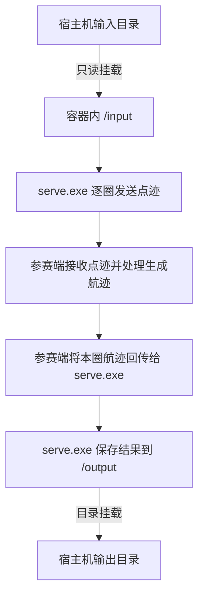
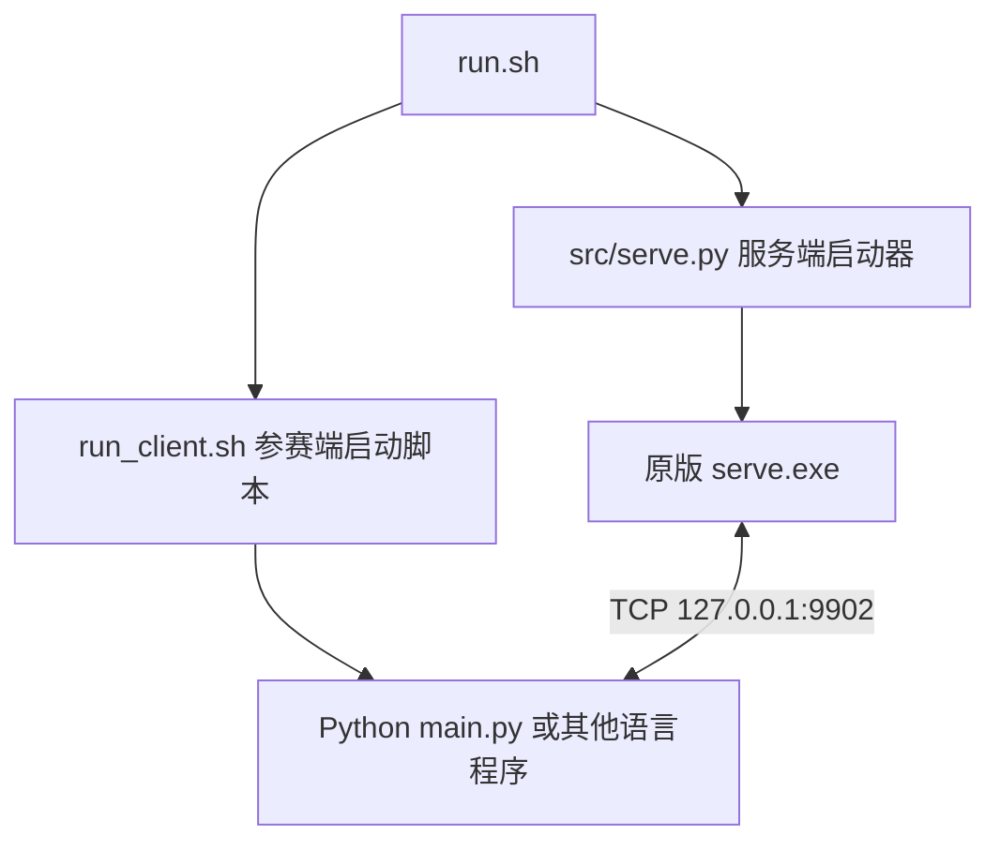
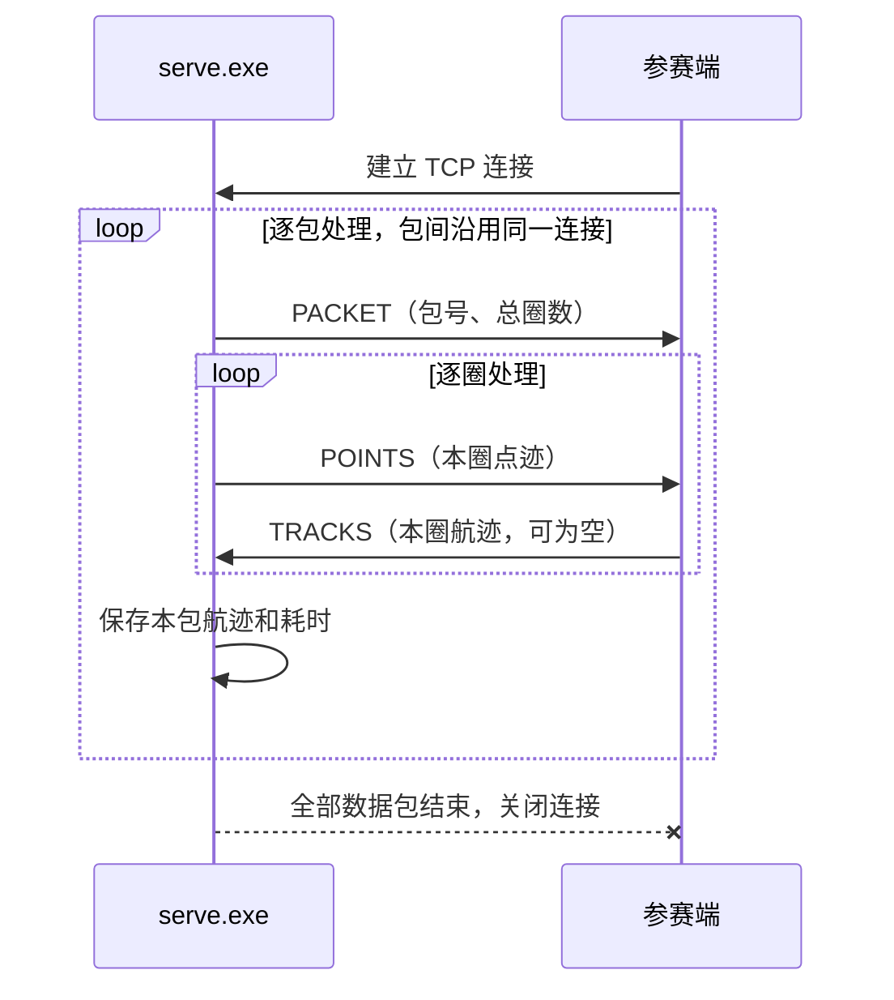

# 参赛程序使用说明（Docker 版）

## 1. 概览

本示例在一个 Docker 容器内完成「接收点迹 → 调用参赛方程序 → 回传航迹 → 保存结果」。包内包含原版收发软件 `serve.exe`、输入输出接口和一包测试数据，不包含模型、权重或训练代码。

**参赛方只需安装 Docker。** Python 3.12 和收发软件运行环境由镜像提供；当前示例不需要显卡。按第 2 节构建、运行后，Python 用户按第 4 节修改处理函数，其他语言用户按第 5 节替换客户端启动命令。

### 1.1 数据交互流程

输入数据从宿主机只读挂载到容器的 `/input`，结果通过 `/output` 挂载回宿主机。服务端和参赛端在同一容器内逐圈通信，运行时可以关闭外部网络。



**每圈都必须回传，包括没有航迹结果的圈。** 示例在有点迹时回传第一个点，没有点迹时返回空列表；客户端会发送对应回包，服务端保存结果和逐圈耗时。

### 1.2 参赛方要做的

参赛方需要完成「点迹 → 航迹」的关联与跟踪：判断哪些点来自同一目标，并为同一目标在不同圈的点分配一致的航迹批号 `BatchID`。

使用 Python 时，主要修改 [`src/algorithm.py`](src/algorithm.py) 中的 `process_circle(points, state)`，示例已封装数据接收、结果编码和回传。使用其他语言时，修改 [`run_client.sh`](run_client.sh) 启动自己的 TCP 客户端，按第 5 节实现收发协议。两种方式均由独立运行的 `serve.exe` 保存结果。

## 2. 快速开始（首次使用请从这里开始）

解压后进入 `participant_demo` 目录，以下命令均在该目录执行。

### 第 0 步：准备 Docker

使用 Linux x86_64 上的 Docker Engine，或 Windows 上运行 Linux 容器的 Docker Desktop。先启动 Docker，再检查服务是否可用：

```bash
docker version
```

输出应包含 Client 和 Server 信息。本示例使用 **Linux amd64 镜像**，首次构建需要联网下载基础镜像和运行组件。

### 第 1 步：构建镜像

下面这条命令在 Bash 和 PowerShell 中都可以执行：

```bash
docker build --platform linux/amd64 -t participant-demo:v1 .
```

构建成功后，镜像中已包含收发软件、Python 接口和运行环境。

### 第 2 步：挂载输入、输出目录并运行

示例输入位于 `data/inputs/`。创建空的 `output/` 目录后，按使用的终端选择下面一组命令。

#### Linux / WSL（Bash）

```bash
mkdir -p output
docker run --rm --network none \
  --mount "type=bind,source=$(pwd)/data/inputs,target=/input,readonly" \
  --mount "type=bind,source=$(pwd)/output,target=/output" \
  participant-demo:v1 --task all --test --out-dir /output
```

#### Windows（PowerShell）

```powershell
New-Item -ItemType Directory -Path output
docker run --rm --network none --mount "type=bind,source=${PWD}/data/inputs,target=/input,readonly" --mount "type=bind,source=${PWD}/output,target=/output" participant-demo:v1 --task all --test --out-dir /output
```

#### Bash 命令详解

上面的 Bash 示例共 5 行：第 1 行创建目录，第 2～5 行合起来是一条 `docker run` 命令。第 2～4 行末尾的 `\` 表示命令在下一行继续，复制时请保留；最后一行不加 `\`。

| 行 | 命令原文 | 含义 |
| --- | --- | --- |
| 第 1 行 | `mkdir -p output` | 在当前目录下创建 `output` 文件夹，用于接收结果。`-p` 表示目录已存在时不报错，但不会清空已有文件；运行前仍须确保该目录为空。 |
| 第 2 行 | `docker run --rm --network none` | 从镜像创建并启动一个容器。`--rm` 表示运行结束后自动删除该容器；挂载在宿主机上的输出文件仍保留。`--network none` 禁用容器的外部网络，容器内的服务端和参赛端仍可通过 `127.0.0.1` 通信。 |
| 第 3 行 | `--mount "type=bind,source=$(pwd)/data/inputs,target=/input,readonly"` | 将当前目录下的 `data/inputs` 文件夹映射为容器内的 `/input`，供程序读取测试数据；`readonly` 表示容器不能通过此挂载修改输入文件。 |
| 第 4 行 | `--mount "type=bind,source=$(pwd)/output,target=/output"` | 将当前目录下的 `output` 文件夹映射为容器内的 `/output`。程序写入 `/output` 的结果会直接保存在宿主机的 `output` 中；此处没有 `readonly`，允许写入。 |
| 第 5 行 | `participant-demo:v1 --task all --test --out-dir /output` | 使用第 1 步构建的 `participant-demo:v1` 镜像启动程序，并将镜像名后面的三个参数传给容器内的程序，具体含义见下表。 |

**`--mount` 参数说明**

命令通过--mount参数进行挂载，让容器通过自己的路径访问宿主机上的文件夹。第 3 行负责输入，第 4 行负责输出；两行均使用以下写法：

| `--mount`子参数 | 作用 |
| --- | --- |
| `type=bind` | 将宿主机的一个文件夹映射到容器内。 |
| `source=...` | 指定宿主机上的文件夹。`$(pwd)` 表示 Bash 当前所在目录，因此 `source=$(pwd)/data/inputs` 是输入文件夹，`source=$(pwd)/output` 是输出文件夹。 |
| `target=...` | 指定同一文件夹在容器内的访问路径。输入使用 `target=/input`，输出使用 `target=/output`。 |
| `readonly` | 单独的只读选项，仅加在输入挂载上。`target=/input,readonly` 中的逗号用于分隔选项，实际容器路径是 `/input`，并非 `/input,readonly`。 |

例如，若在宿主机的 `/home/user/participant_demo` 目录执行命令，路径对应关系如下：

| 宿主机路径 | 容器内路径 | 用途 |
| --- | --- | --- |
| `/home/user/participant_demo/data/inputs/train_001.dat` | `/input/train_001.dat` | 程序从这里读取输入数据。 |
| `/home/user/participant_demo/output/run_summary.json` | `/output/run_summary.json` | 程序写入运行摘要，结束后在宿主机查看。 |

**镜像名之后的程序参数**

| 命令中的部分 | 作用 |
| --- | --- |
| `participant-demo:v1` | 镜像名称及标签，与第 1 步构建命令中的 `-t participant-demo:v1` 对应。 |
| `--task all` | 将任务标识设为 `all`，记录到运行摘要中。本示例不会据此筛选数据包，而是处理输入目录中的全部有效数据包。 |
| `--test` | 启用与评测平台兼容的调用标志，无需在后面填写值。本示例仍处理全部输入圈次，不会因此缩短运行。 |
| `--out-dir /output` | 告诉程序将结果写入容器内的 `/output`；它与输出挂载的 `target=/output` 对应，结果才能保存到宿主机的 `output` 文件夹。 |

`--rm`、`--network` 和 `--mount` 是 Docker 参数，放在镜像名前；`--task`、`--test` 和 `--out-dir` 是参赛程序参数，放在镜像名后。

#### PowerShell 命令说明

PowerShell命令示例与Bash示例的作用相同，对应关系如下：

- `New-Item -ItemType Directory -Path output` 创建输出文件夹：`-ItemType Directory` 指定创建目录，`-Path output` 指定目录名。若目录已存在，请确认它为空，或按第 4 步换一个新目录。
- `${PWD}` 表示 PowerShell 当前所在目录，与 Bash 示例中的 `$(pwd)` 作用相同。例如，在 `D:/participant_demo` 中执行时，`source=${PWD}/data/inputs` 指向宿主机的 `D:/participant_demo/data/inputs`。
- PowerShell 示例将完整的 `docker run` 写在同一行，不需要 Bash 的续行符 `\`；其余参数与上述说明相同。容器内路径仍使用 `/input` 和 `/output`。

`run.sh` 会分别启动服务端和参赛端两个独立进程。启动时需要初始化收发软件环境，随后每处理 100 圈显示一次进度。保持终端打开，等待收发完成。

### 第 3 步：查看结果

终端出现 **`[demo] 收发完成`**，且 `output/run_summary.json` 中的 `status` 为 `success`，表示本次收发和输出文件检查通过。

```text
output/
├── train_001.dat          回传航迹，由 serve.exe 加密保存
├── train_001_rt.dat       逐圈回传耗时，由 serve.exe 保存
├── run_summary.json      运行状态、包数、圈数和输出点数（依据服务端记录）
└── logs/
    ├── server.log        收发软件日志
    ├── serve-config.json 本次运行自动生成的服务端配置
    └── exe-runtime.log   收发软件运行环境日志
```

输入有多个数据包时，每包分别生成 `<包名>.dat` 和 `<包名>_rt.dat`。

示例对每个有点迹的圈回传 1 个点，空圈回传 0 个点。它只演示输入输出格式，不包含关联与跟踪算法或评分软件。

### 第 4 步：更换数据或再次运行

使用自己的数据时，将运行命令中输入挂载的 `source` 改为该数据目录的绝对路径，例如 Bash 下的 `/home/user/contest_data`，或 PowerShell 下的 `D:/contest_data`。

`.dat` 文件应直接位于输入目录中，每个文件作为一个数据包。不要将已生成的航迹文件或 `_rt.dat` 耗时文件放入输入目录。

每次运行都需要一个空输出目录。再次运行时，创建 `output2/` 并将输出挂载的宿主机路径改为该目录，容器内仍使用 `/output`。需要提前结束时，在运行终端按 `Ctrl+C`。

## 3. 程序组成与容器接口

### 3.1 目录说明

```text
participant_demo/
├── Dockerfile                 镜像构建文件
├── run.sh                     容器入口，分别启动并管理服务端和参赛端
├── run_client.sh              参赛端启动命令，更换语言时修改这里
├── requirements.txt           Python 依赖声明，当前无第三方依赖
├── README.md                  参赛方使用说明
├── data/
│   ├── official/serve.exe     原版数据收发软件
│   └── inputs/train_001.dat   一包原始测试输入
├── src/
│   ├── algorithm.py          参赛方处理函数，主要修改这里
│   ├── client.py             点迹接收、航迹检查与回传
│   ├── main.py               独立 Python 参赛端入口，只连接 TCP
│   ├── serve.py              独立服务端入口，运行 serve.exe 并检查输出
│   ├── exe_runtime.py        收发软件运行辅助
│   └── windows_job.py        子进程清理辅助
├── docs/protocol.md           Socket 协议速查
└── tests/                    协议、独立进程和退出清理检查
```

容器通过 Wine 运行原版 `serve.exe`，点迹发送和结果落盘均由该软件负责。

### 3.2 固定的输入输出约定

| 项目 | 容器内约定 |
| --- | --- |
| 程序入口 | `/app/program/solution/run.sh` |
| 输入目录 | `/input`，环境变量 `DATA_ROOT=/input` |
| 输出目录 | `--out-dir` 指定的目录，示例与评测均使用 `/output` |
| 平台调用参数 | `--task <任务值> --test --out-dir /output` |
| 进程退出码 | `0` 表示运行成功；异常或中断时返回非零值 |

输入和输出应挂载为两个独立目录。Python 处理函数通过参数接收点迹并返回航迹列表；其他语言通过 TCP 接收点迹并回传航迹。参赛端均无需自行读写 `.dat` 文件。

### 3.3 运行参数

下面这些参数放在 `docker run` 的镜像名之后，传给容器内的程序：

| 参数 | 示例使用值 | 说明 |
| --- | --- | --- |
| `--task` | `all` | 任务标识，记录在运行摘要中，不筛选输入包 |
| `--test` | 启用 | 兼容平台调用，仍处理全部输入圈次 |
| `--out-dir` | `/output` | 必须与输出挂载的容器路径一致 |
| `--input-dir` | 默认取 `/input` | 如需更改容器内的输入位置，可显式指定 |
| `--port` | 默认 `9902` | 容器内收发两端共用的端口 |

示例镜像默认命令已经包含 `--task all --test --out-dir /output`。如果在镜像名后传入自定义参数，请保留 `--out-dir /output`。运行配置由启动器生成到 `/output/logs/serve-config.json`。

### 3.4 服务端与参赛端分别运行

容器内的启动关系如下，两个进程通过 TCP 通信：



- `src/serve.py` 不导入 `main.py`、`client.py` 或 `algorithm.py`，也不负责启动参赛端。
- `src/main.py` 是可单独运行的 Python 客户端，不启动或管理 `serve.exe`。
- `run.sh` 先等待服务端完成环境初始化，再运行 `run_client.sh`。此时服务进程已启动，客户端仍应重试连接，直到服务端开始监听；Python 示例最多重试 30 秒。
- 正常运行时，两端都成功退出且服务端输出检查通过，整个容器才返回 `0`。一端失败或收到停止信号时，启动脚本负责清理另一端及参赛端子进程；一端先结束后，另一端最多有 60 秒完成收尾。

`run_summary.json` 的包数、圈数和输出点数由服务端日志核对生成，不要求参赛端提供统计文件。Python 客户端另外在终端输出收到的输入点数；更换语言不影响服务端结果文件的生成和检查。

## 4. 参赛方算法接入（Python）

### 4.1 需要实现的函数

打开 [`src/algorithm.py`](src/algorithm.py)，示例取本圈第一个点，逐字段填写输出字典，再用列表返回：

```python
def process_circle(points, state):
    # points：本圈点迹列表；state：同一数据包内保留的跨圈状态。
    if not points:
        return []

    point = points[0]
    track = {
        "Time": point["Time"],
        "Azimuth": point["Azimuth"],
        "Elevation": point["Elevation"],
        "Distance": point["Distance"],
        "BatchID": 1,  # 示例编号，实际使用时由参赛方程序分配。
        "CircleID": point["CircleID"],
        "PntID": point["PntID"],
    }
    return [track]
```

**这段代码仅演示字段赋值和返回格式。** 固定取第一个点、固定填写 `BatchID = 1` 不代表这些点属于同一目标；正式接入时需替换为自己的选点和航迹编号逻辑。

| 名称 | 类型 | 含义 |
| --- | --- | --- |
| `points` | `list[dict]` | 本圈点迹，每个字典表示一个点；可能为空列表 |
| `state` | `dict` | 同一数据包内持续保留的状态，换包时自动清空 |
| 返回值 | `list[dict]` | 本圈需要上报的航迹点；没有结果时返回 `[]` |

可将历史点、已有航迹及编号等信息保存在 `state` 中。新数据包到来时，客户端会创建新的空字典，参赛方无需另外实现换包重置函数。

### 4.2 输入点迹格式

`points` 中每个点包含以下字段。Python 接口中，整数使用 `int`，浮点数使用 `float`。

| 字段 | 类型 | 含义 |
| --- | --- | --- |
| `Time` | `int` | 雷达时刻，单位毫秒 |
| `Azimuth` | `float` | 方位角，已归一化 |
| `Elevation` | `float` | 俯仰角，已归一化 |
| `Distance` | `float` | 距离，已归一化 |
| `Amp` | `float` | 幅度，已归一化 |
| `SNR` | `float` | 信噪比，已归一化 |
| `CircleID` | `int` | 圈号 |
| `PntID` | `int` | 原始点号 |

### 4.3 输出航迹格式

返回列表中的每个字典表示一个选中的航迹点，包含以下字段：

| 字段 | 类型 | 填写要求 |
| --- | --- | --- |
| `Time` | `int` | 保留原始点的雷达时刻 |
| `Azimuth` | `float` | 保留原始点的方位角 |
| `Elevation` | `float` | 保留原始点的俯仰角 |
| `Distance` | `float` | 保留原始点的距离 |
| `BatchID` | `int` | 航迹批号，必须大于 0 |
| `CircleID` | `int` | 保留原始点的圈号 |
| `PntID` | `int` | 保留原始点的点号 |

第 4.1 节的示例按上述字段构造 `track`，返回 `[track]`。没有输入点或没有航迹结果时返回 `[]`，客户端会自动发送空 `TRACKS` 回包。

回传结果需要满足以下要求：

1. 同一目标跨圈使用相同的 `BatchID`；不同目标使用不同编号。杂波点不放入返回列表。
2. 输出对应本圈收到的原始点，保留其时间、圈号、点号和坐标；同一个点在本圈结果中只上报一次。
3. 整数字段使用 Python `int`，范围为 `0` 到 `4294967295`，其中 `BatchID` 必须大于 `0`。
4. 每次调用都返回列表。没有航迹或没有输入点时返回 `[]`，客户端会自动发送空回包。

### 4.4 调用时序与耗时要求

| 事件 | Demo 的处理 |
| --- | --- |
| 收到 `PACKET` 包首消息 | 记录包号和总圈数，将 `state` 重置为空字典 |
| 收到一圈 `POINTS` | 调用一次 `process_circle(points, state)` |
| 处理函数返回 | 检查结果字段，编码并发送一个 `TRACKS` 回包 |
| 全部数据处理完成 | 客户端核对包数与圈数后退出；独立服务端检查落盘结果并保存运行摘要 |

服务端要求每圈在 **30 秒内**回传，参赛方应为数据收发留出余量。处理函数返回、结果编码后，若本圈已经耗时 29 秒，Demo 会报错退出，避免迟到结果被错当成下一圈回包。Demo 不会强行中断仍在执行的函数，请自行控制处理耗时。

修改处理代码或增加依赖后，重新执行第 2 节的镜像构建命令，再换一个空输出目录运行。第三方 Python 依赖统一写入 `requirements.txt`，由 Docker 构建过程安装。

## 5. 更换参赛端语言与独立运行

默认客户端和 `serve.exe` 在同一个容器内，通过 `127.0.0.1:9902` 通信。本节说明容器内的数据收发协议。

使用随包 Python 接口时，收发逻辑已经封装在 `src/client.py` 中。C++、Java、Go 等语言可以直接实现相同协议，无需调用 Python 处理函数。协议速查见 [`docs/protocol.md`](docs/protocol.md)。

**替换参赛端启动命令：**

将自己的程序及运行依赖放入镜像，然后修改 `run_client.sh` 的最后一行。例如，已准备好 Linux amd64 可执行文件 `bin/contestant` 时：

```bash
exec ./bin/contestant
```

`run.sh` 会向参赛端提供以下环境变量，自己的程序可直接读取：

| 环境变量 | 含义 | 示例值 |
| --- | --- | --- |
| `SERVER_HOST` | 收发软件的连接地址 | `127.0.0.1` |
| `SERVER_PORT` | 本次服务端端口，与 `run.sh --port` 一致 | `9902` |
| `EXPECTED_PACKAGES` | 本次输入目录中的数据包数量，供客户端在连接结束时核对 | `1` |

如果自己的程序使用命令行参数接收配置，可在 `run_client.sh` 中转换。例如，**仅当自己的程序实现了这些参数名时**，可以写：

```bash
exec ./bin/contestant --host "$SERVER_HOST" --port "$SERVER_PORT" --expected-packages "$EXPECTED_PACKAGES"
```

根据语言在 `Dockerfile` 中增加编译步骤或运行环境；自行编译的程序需兼容镜像中的 Linux amd64 环境。运行前重新构建镜像。保留 `run_client.sh` 中的 `exec`，让程序在前台运行；全部包和圈收发完整后返回 `0`，异常时返回非零退出码。不要在启动命令末尾添加 `&`。

其他语言客户端只需遵守 TCP 协议、连接配置和退出码约定，不需要生成 Python 专用文件，也无需启动、停止或修改 `serve.exe`。输入输出目录和 Docker 的运行命令保持不变。

**需要分别启动以便调试时：**

下面以 Bash 为例。先创建空的 `output-debug` 目录，启动一个命名的交互式容器：

```bash
mkdir -p output-debug
docker run --rm -it --name participant-demo-debug --network none \
  --mount "type=bind,source=$(pwd)/data/inputs,target=/input,readonly" \
  --mount "type=bind,source=$(pwd)/output-debug,target=/output" \
  --entrypoint bash participant-demo:v1
```

在该容器终端内启动服务端，等待出现 `[demo] 启动收发软件`：

```bash
python3 -u src/serve.py --input-dir /input --out-dir /output --port 9902 --task all --test
```

再打开一个宿主机终端，在**同一个容器**内启动 Python 客户端；示例输入为 1 包，如替换了数据请同步修改数量：

```bash
docker exec -it participant-demo-debug python3 -u src/main.py --host 127.0.0.1 --port 9902 --expected-packages 1
```

也可以将 `docker exec` 命令中的 `python3 ...` 替换为自己的客户端及参数。手动启动时没有 `run.sh` 的统一进程管理，需要自行停止两端；此时 `run_summary.json` 仅表示服务端检查结果，客户端退出状态应另行确认。调试完成后，退出交互式容器，或执行 `docker stop participant-demo-debug`。


### 5.1 消息格式

服务端与参赛端通过 TCP Socket 通信。所有数值采用**小端序**，记录连续排列，不插入对齐填充。连接建立后，参赛端等待服务端下发消息，不发送握手字节。

消息分为三种：`PACKET`（包首信息）、`POINTS`（一圈点迹）、`TRACKS`（一圈回传航迹）。三种消息共用以下帧结构：

| 起始偏移 | 长度（字节） | 字段 | 含义 |
| --- | --- | --- | --- |
| `0` | `4` | `NumBytes` | uint32，等于 `1 + DataLen`，不包含自身和消息尾 |
| `4` | `1` | `tag` | `0x01` 为 PACKET，`0x02` 为 POINTS，`0x03` 为 TRACKS |
| `5` | `DataLen` | `data` | 消息负载，结构见下表 |
| `5 + DataLen` | `4` | `END` | uint32，恒为 0 |

| 消息 | `DataLen` | `NumBytes` | 整帧长度 |
| --- | --- | --- | --- |
| `PACKET` | `8` | `9` | `17` 字节 |
| `POINTS` | `32 × N` | `1 + 32 × N` | `9 + 32 × N` 字节 |
| `TRACKS` | `28 × M` | `1 + 28 × M` | `9 + 28 × M` 字节 |

`N` 为本圈输入点数，`M` 为本圈回传点数。**空 TRACKS 也必须发送**，此时 `M = 0`，整帧为 9 字节：

```text
01 00 00 00 03 00 00 00 00
```

### 5.2 消息负载

`PACKET` 的负载固定为 8 字节，包含以下两个字段：

| 字段 | 网络类型 | 含义 |
| --- | --- | --- |
| `PacketIndex` | uint32 | 数据包序号 |
| `CircleCount` | uint32 | 本包将下发的 POINTS 帧数 |

`POINTS` 和 `TRACKS` 的字段含义见第 4 节，网络传输时按以下顺序排列：

| 消息 | 字段顺序 | 网络类型（与字段逐一对应） |
| --- | --- | --- |
| `POINTS` | Time、Azimuth、Elevation、Distance、Amp、SNR、CircleID、PntID | uint32、float32、float32、float32、float32、float32、uint32、uint32 |
| `TRACKS` | Time、Azimuth、Elevation、Distance、BatchID、CircleID、PntID | uint32、float32、float32、float32、uint32、uint32、uint32 |

TCP 的一次 `recv` 不保证收到完整消息，接收端需要按指定长度循环读取，并检查消息尾。每条 POINTS 记录为 32 字节，每条 TRACKS 记录为 28 字节。

### 5.3 收发时序与异常处理



每个 `POINTS` 必须对应一个 `TRACKS`，不要跳过空回包或将多圈结果合并回传。读到连接结束时，还需要核对实际收到的数据包数和各包圈数。

下面的字段与 29 秒检查由随包 Python 客户端实现；更换语言时应自行实现相应检查。

| 情况 | 本 Demo 的处理方式 |
| --- | --- |
| 输出字段缺失、点号不匹配或批号无效 | 报错退出，修正返回结果后重新运行 |
| 处理函数返回后，本圈已耗时 29 秒 | 报错退出，不发送迟到结果 |
| 数据未收完整、连接异常或包数不足 | 报错退出，不按正常完成处理 |
| 全部包和圈均处理完，服务端正常退出 | 检查输出文件与统计后结束 |

本 Demo 不提供断点续跑。异常退出后，修正问题并换一个空输出目录，重新完整运行。

## 6. 常见问题

| 问题 | 检查或处理方式 |
| --- | --- |
| `docker version` 只有 Client，或提示无法连接 Docker | 启动 Docker 服务；Windows 上确认 Docker Desktop 已启动并使用 Linux 容器 |
| 镜像构建时下载失败 | 检查构建机网络，确保能获取基础镜像和系统运行组件 |
| 提示挂载路径不存在 | 先创建宿主机目录，检查 `--mount` 中的 `source` 路径 |
| 提示输出目录不为空 | 创建新的空目录，并更新输出挂载的宿主机路径 |
| 提示输入目录无有效 `.dat` | 确认挂载的输入目录中直接包含非空 `.dat` 文件 |
| 修改代码后运行效果没有变化 | 修改源码后重新执行 `docker build`，再运行新镜像 |
| 输出点数一直为 0 | 示例在有输入点时应回传 1 个点；检查处理函数是否返回 `[]`，并确认修改源码后已重新构建镜像 |
| 输出字段或单圈耗时报错 | 按第 4 节检查返回格式与耗时，再查看 `run_summary.json` 和 `logs/server.log` |
| 收发软件启动失败 | 查看输出目录中的 `logs/server.log` 和 `logs/exe-runtime.log` |
| 结果 `.dat` 无法作为普通文本打开 | 结果由原版软件保存；运行概况查看 `run_summary.json` 和日志 |

参数或路径检查阶段的错误直接显示在终端，此时可能尚未创建日志目录。运行阶段发生错误时，先查看 `run_summary.json` 中的 `status` 和 `error`。

如需检查接口代码，在已经构建的镜像中执行：

```bash
docker run --rm --network none --entrypoint python participant-demo:v1 -B -m unittest discover -s tests -v
```

## 7. 提交与离线交付

### 7.1 整理参赛代码包

接入自己的处理逻辑并验证后，将本目录重命名为 `<team_id>_<version>_code`，压缩成同名 ZIP。例如：

```text
team001_v1_code.zip
└── team001_v1_code/
    ├── Dockerfile
    ├── run.sh
    ├── requirements.txt
    ├── README.md
    ├── src/
    └── data/
```

确认解压后能找到 `<team_id>_<version>_code/Dockerfile`。代码包中保留运行所需的软件、源码和依赖声明，不放入本地输出目录或导出的镜像文件。当前示例仅用于接口联调，正式提交前需替换为自己的处理逻辑。

### 7.2 离线机器运行

在已成功构建镜像的机器上导出：

```bash
docker save -o participant-demo-v1.tar participant-demo:v1
```

将镜像文件和需要使用的输入数据复制到目标机器，在镜像文件所在目录导入：

```bash
docker load -i participant-demo-v1.tar
```

然后按第 2 节的运行命令挂载目标机器上的输入、输出目录。目标机器需要已安装并启动 Docker，导入后无需联网安装 Python 或其他运行依赖。
